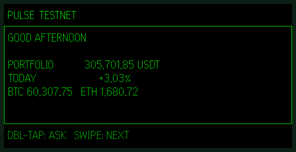
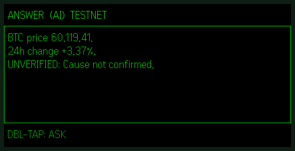
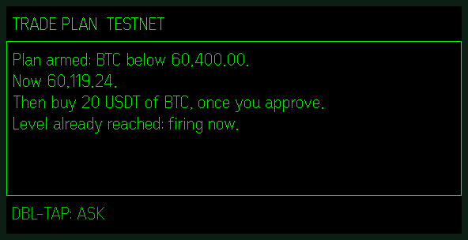
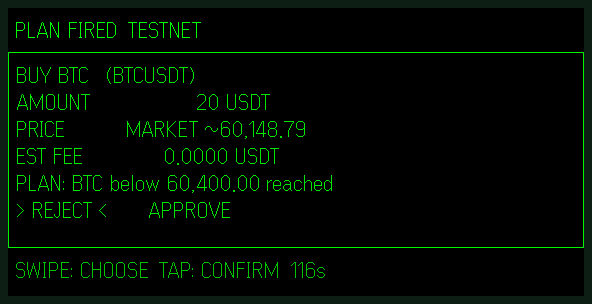
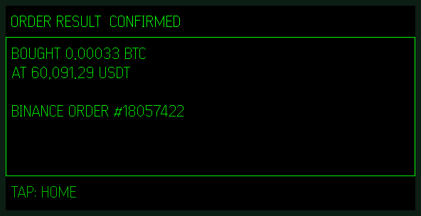
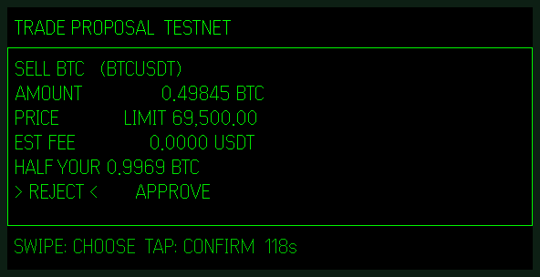
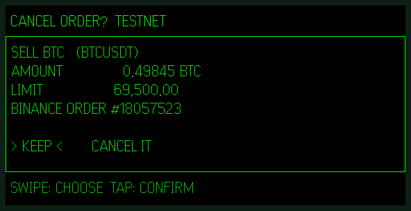
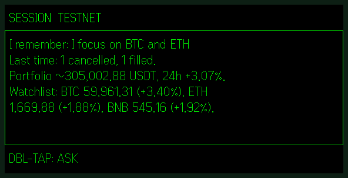

# PULSE

**Your financial world, at a glance.** A voice-first trading copilot for Even Realities G2 smart glasses.
Heads Up: Even Realities Hackathon 2026, track **Exchanges & Stocks** (Binance), currently running on **Binance Spot Testnet**. 

**[Watch the demo video](https://www.youtube.com/watch?v=B5mK4iPqPEI)** (2:56)

**The problem.** Checking a position or acting on a price move means pulling out a phone, and "trading by voice" is dangerous without guardrails.
**For whom.** Active traders who want a glance, a short phrase and one confirming tap.
**How.** The glasses show one thing at a time. A backend reads Binance, an AI only explains, and nothing is traded or cancelled until you confirm the exact terms on the lens.

> **AI interprets. Verified services retrieve data. The backend validates. The user authorizes. Binance executes.**

| | |
|---|---|
|  <br> Glance |  <br> Why is it moving? Facts, and what is unverified |
|  <br> Decide while calm |  <br> Confirm fast, safe by default |
|  <br> What Binance confirmed |  <br> "Sell half my Bitcoin" |
|  <br> Cancel by voice, confirm by hand |  <br> It remembers |

Screens are captured from the Even Hub simulator (576 x 288).

## Try it in two minutes: no server, no keys

**Packaged app:** [`release/pulse.ehpk`](https://github.com/nofazechris/pulse/raw/main/release/pulse.ehpk) (opens in practice mode when no server is running).

```powershell
npm install
npm run dev:glasses    # first terminal
npm run simulator      # second terminal
```

With no server running, the first screen offers **practice mode**: double-tap. Double-tap again for a list of requests, swipe to choose, tap to run, then swipe and tap to approve. The packaged `pulse.ehpk` offers the same.

Practice mode uses **sample prices and a made-up account, and simulates orders**. Every screen is marked DEMO or SIMULATED, nothing touches the network, and speech is off because speech-to-text needs the server. The demo video shows the real mode against Binance Spot Testnet; to run that yourself, follow [Setup](#setup).

## What you can say

| Say | What happens |
|---|---|
| "Pulse, start my trading session" | Greeting from live data, plus what you asked it to remember |
| "What's my biggest holding?" / "Show my portfolio" | Real balances, valued; unpriced test coins are left out |
| "How is Bitcoin doing?" / "Why is Bitcoin moving today?" | Price, move and range; an answer that labels what it cannot verify |
| "Buy 20 dollars of Bitcoin" / "Buy Bitcoin" | A proposal to approve; with no amount it suggests your usual or last one, labelled |
| "Sell half my Bitcoin" (also a quarter, all, N percent) | The backend sizes the exact quantity you approve |
| "Buy 20 dollars of Bitcoin at 50000" | A limit order that can rest on the exchange |
| "Alert me if Bitcoin drops 2 percent and buy 20 dollars" | A trade plan (below) |
| "Show my plans" / "Cancel all plans" | Manage plans |
| "Show my open orders" / "Cancel my order" | Speech picks the order; a swipe and a tap cancel it |
| "How is my session?" | Profit and loss since the session started |
| "Remember that I focus on BTC and ETH" | Saved memory you can review and delete |

Gestures: **double tap** talks (and cancels a proposal), **swipe** chooses or scrolls, **tap** confirms, **long press** goes back.

## Trade plans: decide calm, confirm fast

*"Alert me if Bitcoin drops 2 percent and buy 20 dollars"* or *"If Bitcoin rises 5 percent, sell half."* The server watches the price, even when the app is closed. A G2 app cannot alert you while it is closed, so you see it when you open PULSE: if the level still holds, the **prepared order** appears with REJECT preselected; if the price has moved back, you are told and nothing is prepared. A plan never trades by itself, never replaces a decision you are in the middle of, fires once, and expires after 24 hours.

## Why a trader would trust it

- Approval is bound to a SHA-256 hash of the exact terms shown; changed terms need a new approval.
- Execution is idempotent and reconciled with Binance: a network failure never sends an order twice, and "success" is shown only when Binance confirms it.
- The model cannot approve, execute or cancel; those intents come only from a deterministic parser, and the backend re-checks every order against exchange rules and balances.
- Verified numbers come from the exchange. AI interpretation and unverified claims are labelled.

## Who it is for, and how it could pay

Built for active retail traders on Binance who cannot watch a screen all day. The safety layer sits behind an exchange adapter, so other exchanges can be added without changing the glasses experience. Possible models, none built yet: a subscription for plans and alerts, or partnerships with exchanges. Demand and pricing are not validated yet.

## What works

- Glasses app (Vite + React + TS, official Even Hub SDK) with screens for connection, home, portfolio, market, watchlist, AI insight, trade proposal and execution result, sized for 576x288 monochrome green.
- Voice pipeline (mic -> backend STT -> intent -> verified data -> display) with a typed-transcript fallback that uses the same path; gesture navigation validated against the simulator.
- Backend (Fastify, Zod, Pino) over Binance Spot Testnet: public market data, signed account data, portfolio valuation, watchlist, orders.
- Trade flow: proposal -> exact-terms approval -> idempotent execution -> reconciliation; market and limit orders, selling a share, open orders and cancelling.
- Server-side trade plan watching, session profit and loss, smart default amounts.
- 271 automated tests (fake exchange + Neon); the order flows were also checked live on Binance Spot Testnet.
- Persistent memory, preferences, sessions, audit log in **Neon PostgreSQL** (Drizzle).
- Replaceable AI provider (Anthropic / OpenAI-compatible) and STT provider, each with a deterministic fallback.

See [docs/PROJECT.md](docs/PROJECT.md) (decisions, rules, status), [ARCHITECTURE](docs/ARCHITECTURE.md), [API](docs/API.md), [DATABASE](docs/DATABASE.md), [SECURITY](docs/SECURITY.md), [TESTING](docs/TESTING.md), [HACKATHON_COMPLIANCE](docs/HACKATHON_COMPLIANCE.md), [DEMO_SCRIPT](docs/DEMO_SCRIPT.md), [DEPLOY](docs/DEPLOY.md), [SUBMISSION](docs/SUBMISSION.md).

## Layout

```
apps/glasses     Even Hub app: sdk adapters, typed API client, controller, screens, companion panel, app.json
apps/api         Fastify API: exchange, market, portfolio, trading, agent, ai, memory, sessions, db, security
packages/shared  zod contracts, exact decimal maths, formatting, G2 display facts
docs/            documentation + smoke-test screenshots
```

## Requirements

Node 22.13+ or 24 (developed on 24.15), npm, Git. A free [Neon](https://neon.com) project and a [Binance Spot Testnet](https://testnet.binance.vision) API key (log in with GitHub; HMAC key). LLM and STT keys are optional.

## Setup

```powershell
npm install
# create apps/api/.env from the template below, then:
npm run db:migrate                                  # creates the 15 tables in Neon
npm run db:check                                    # one query against Neon
```

Create `apps/api/.env` (git-ignored; never commit it) and fill in the blank values:

```
NODE_ENV=development
HOST=0.0.0.0
API_PORT=8787
API_BASE_URL=http://localhost:8787
LOG_LEVEL=info
CORS_ORIGIN=http://localhost:5180

DATABASE_URL=
DATABASE_DIRECT_URL=

BINANCE_ENV=testnet
BINANCE_TESTNET_REST_URL=https://testnet.binance.vision/api
BINANCE_TESTNET_STREAM_URL=wss://stream.testnet.binance.vision/stream
BINANCE_API_KEY=
BINANCE_API_SECRET=

SESSION_SECRET=
SESSION_TTL_MINUTES=120
PAIRING_CODE=

PROPOSAL_TTL_SECONDS=120
PRICE_MOVE_TOLERANCE_PERCENT=1
DEMO_MODE=false
```

| Variable | Notes |
|---|---|
| `DATABASE_URL` | Neon **pooled** connection string (Neon Console -> Connect) |
| `DATABASE_DIRECT_URL` | Neon direct string, used only by migrations |
| `BINANCE_API_KEY` / `BINANCE_API_SECRET` | Testnet key only. URLs are fixed to the testnet and validated |
| `SESSION_SECRET` | >= 32 random characters |
| `PAIRING_CODE` | >= 8 characters; the code you enter (or auto-use in dev) to pair a device |
| `AI_PROVIDER`, `AI_API_KEY`, `AI_MODEL` | Optional. `anthropic` or `openai`; blank = deterministic |
| `STT_PROVIDER`, `STT_API_KEY` | Optional. `openai` (Whisper-compatible); blank = type instead of speak |

For a zero-typing simulator, create `apps/glasses/.env.development.local` (git-ignored; dev server only, never included in a build) with:

```
VITE_API_URL=http://localhost:8787
VITE_DEMO_PAIRING_CODE=<the same value as PAIRING_CODE>
```

## Optional: LLM and voice (speech-to-text)

PULSE works without either (deterministic parser, typed input). To switch them on, add to `apps/api/.env` (never to chat, git or the frontend), then restart `npm run dev` (`.env` is read at start-up) and run `npm run ai:check`:

```
# One OpenAI key powers both (the cheapest current models, Nov 2026):
AI_PROVIDER=openai
AI_API_KEY=<your key>
AI_MODEL=gpt-6-luna
STT_PROVIDER=openai
STT_MODEL=gpt-transcribe
# STT_API_KEY may stay blank: the AI key is reused
# Anthropic instead for the LLM: AI_PROVIDER=anthropic, AI_API_KEY=<key>, AI_MODEL=<model id>
# OpenAI-compatible server: AI_BASE_URL=https://.../v1   (STT_BASE_URL likewise)
```

`npm run ai:check` makes one tiny real call per configured service and prints OK or FAILED with the reason (never the key). What a model sees: a few verified facts (e.g. a price, your portfolio total), your explicit memory notes and preferences, and your question. It never sees credentials, account ids or order history, and it cannot approve or place trades. Please ask the organisers to confirm LLM use ([HACKATHON_COMPLIANCE](docs/HACKATHON_COMPLIANCE.md)).

## Run

```powershell
npm run dev            # API on :8787 and the glasses dev server on :5180
npm run simulator      # Even Hub simulator pointed at :5180 (second terminal)
npm run simulator:auto # same, with the headless control API on :9898 (screenshots/input)
npm run demo           # simulator + scripted demo autopilot with an on-screen teleprompter (for recording the video)
```

Open <http://localhost:5180> in a normal browser to use the companion panel with an in-memory adapter (no simulator needed).

## Scripts

| Script | Does |
|---|---|
| `npm run dev` / `dev:api` / `dev:glasses` | development servers |
| `npm run build` | build the glasses bundle + typecheck the API |
| `npm run typecheck` | strict TypeScript across all workspaces (there is no ESLint; strict `tsc` is the static check) |
| `npm test` | unit + database-backed safety/journey tests (needs Neon; uses a fake exchange) |
| `npm run test:integration` | live Binance **Testnet** + Neon tests, including real small testnet orders through the approval flow |
| `npm run db:generate` / `db:migrate` / `db:studio` / `db:check` | Drizzle Kit and a Neon check |
| `npm run ai:check` | Verify the optional LLM / speech keys with one small call each |
| `npm run simulator` / `simulator:auto` | Even Hub simulator |
| `npm run demo` / `demo:fast` | Simulator + demo autopilot (see [DEMO_SCRIPT](docs/DEMO_SCRIPT.md)); places one small testnet order |
| `npm run pack:ehpk` | build, check the bundle for secrets, `evenhub pack` -> `pulse.ehpk`; add `-- --api https://your.host` for a hosted backend ([DEPLOY](docs/DEPLOY.md)) |

## Safety

Running on Binance Spot Testnet right now (the server refuses any other exchange URL). No withdrawals, deposits, futures, margin or leverage (the endpoints are not reachable). No autonomous execution: nothing is sent without an explicit approval of the exact proposal shown on the glasses, re-validated by the backend. The LLM never holds exchange credentials and can neither approve nor execute. Results shown are what Binance confirmed. Not financial advice. Details and limitations (demo-grade pairing, single shared testnet credential): [docs/SECURITY.md](docs/SECURITY.md).

## Known limitations

- Verified in the Even Hub simulator only; no physical G2 was available. LLM (OpenAI `gpt-6-luna`) and speech-to-text (`gpt-transcribe`) were verified live on 2026-11-26 with synthesised speech; a live voice through the simulator or glasses microphone is still to be tried.
- Neon is ~250 ms per query from some regions; host the API next to the Neon region for a snappy demo ([ARCHITECTURE](docs/ARCHITECTURE.md)).
- The default package talks to a server at `http://localhost:8787`; without one it offers practice mode. Real data on a device needs a hosted HTTPS backend and a package built for it ([DEPLOY](docs/DEPLOY.md)).
- Pairing is demo-grade: one pairing code, one shared demo user and testnet account.
- `binance.com` / `developers.binance.com` may be unreachable on some networks; only `testnet.binance.vision` is needed.

## What existed before Nov 23

Nothing. This repository was created on 2026-11-24; only open-source libraries (see `package.json`) and public APIs are used.
